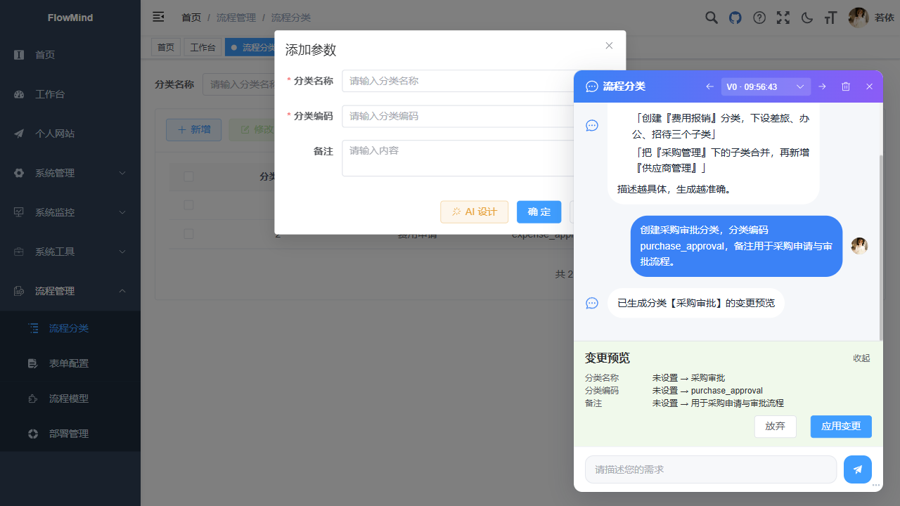
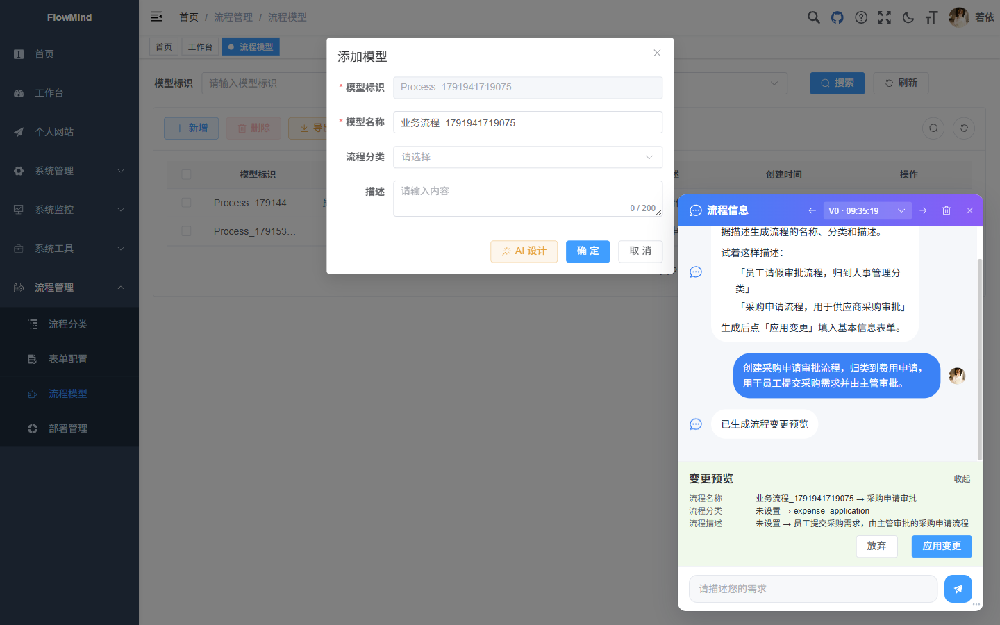
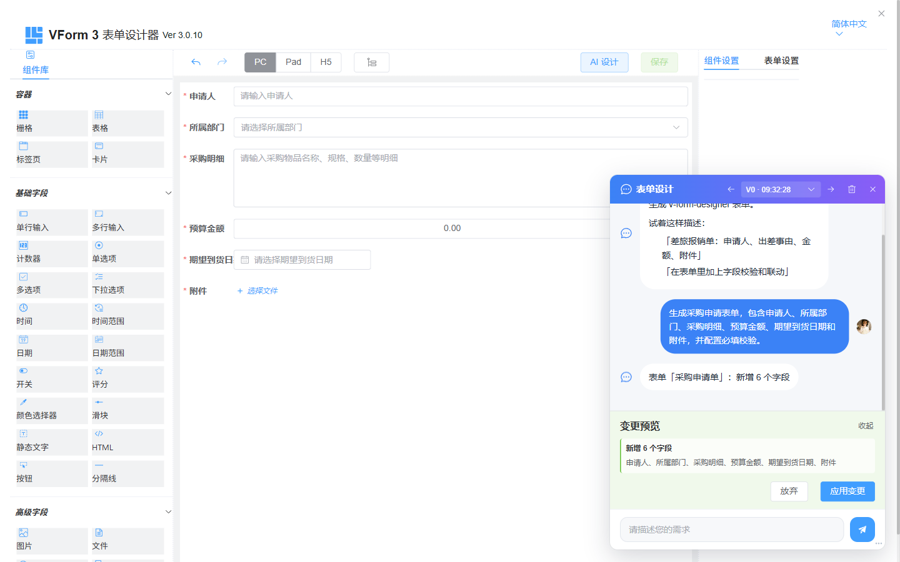
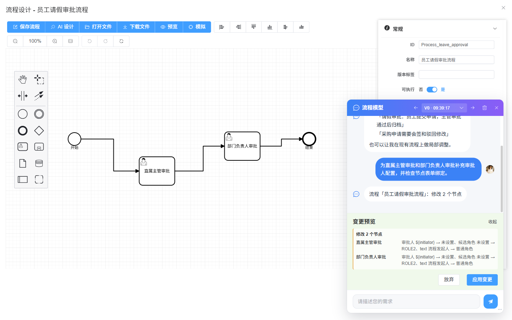
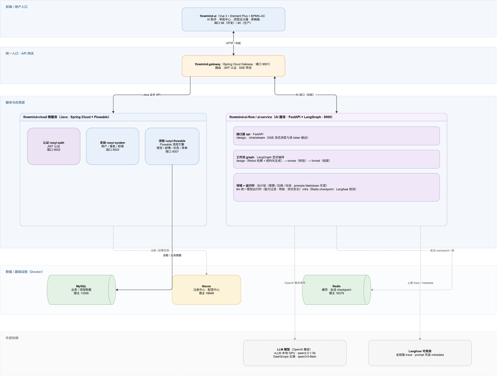

# 开源推荐｜FlowMind：用 AI 生成 Flowable 审批流程，Vue3 + Spring Cloud + LangGraph 全栈实现

> 关键词：AI 工作流、Flowable、BPMN、LangGraph、Spring Cloud、Vue3、智能审批、表单设计、开源项目

如果你正在开发 OA、请假报销、采购审批或合同流转系统，应该遇到过这些问题：业务人员能说清楚需求，却不熟悉 BPMN；开发人员需要反复配置节点、审批人和表单；流程稍有变化，又要重新修改和验证。

**FlowMind 尝试把这段重复工作交给 AI。**

用户只需描述业务需求，AI 就能辅助生成流程分类、基本信息、业务表单和 BPMN 流程。每次结果不会直接覆盖设计，而是先展示结构化变更，确认后再应用到可视化画布。

- GitHub：[https://github.com/Moonlight168/flowmind](https://github.com/Moonlight168/flowmind)
- Gitee：[https://gitee.com/wish168/flowmind](https://gitee.com/wish168/flowmind)
- 开源协议：MIT License

如果这个项目对你有帮助，欢迎点一个 **Star**。你的反馈也会帮助 FlowMind 继续完善 AI 生成质量与流程设计体验。

## 一、FlowMind 是什么？

FlowMind 是一个开源的智能流程审批平台，基于 RuoYi-Cloud、Flowable 和 Vue 3 构建，使用 FastAPI + LangGraph 提供 AI 辅助设计能力。

它覆盖了流程设计、发布和执行的完整链路：

- 流程分类与模型管理
- BPMN 2.0 可视化设计
- 业务表单设计与绑定
- 流程部署、发起与审批
- 待办、已办、待签收和我发起的流程
- 申请草稿、运行轨迹与审批记录
- AI 分类、基本信息、表单和流程设计
- Langfuse 可观测与黄金测试集回归

FlowMind 的目标并不是让 AI 代替设计器，而是让 AI 成为设计器中的协作者：AI 负责理解需求和生成候选变更，用户保留最终决定权。

## 二、从一句业务描述到可编辑流程

传统方式通常要依次创建分类、填写模型信息、设计表单、绘制 BPMN、配置审批人，再检查每个节点是否满足 Flowable 的运行要求。

FlowMind 将这条链路拆成四类 AI 设计能力。

### 1. 流程分类设计

输入分类用途后，AI 生成分类名称、标识和说明，并在写入前展示字段变化。



### 2. 流程基本信息生成

AI 从业务描述中整理流程名称、模型标识、所属分类和说明，降低重复录入成本。



### 3. 可编辑表单生成

AI 不只生成字段名称，还会考虑字段类型、选项、必填校验和布局配置，结果可以继续在 VForm 3 设计器中调整。



### 4. BPMN 流程生成与修改

用户可以描述完整审批路径，也可以要求局部增加节点、调整审批人或修改表单绑定。AI 查询系统中的真实分类、角色、表单和模型后，生成结构化操作，再由用户确认是否应用。



## 三、为什么先预览，再应用？

让大模型直接重写 BPMN XML 看起来简单，但在真实系统中风险很高：节点 ID 可能失效、已有配置可能丢失、表单或角色也可能并不存在。

FlowMind 使用“生成操作 → 校验操作 → 展示预览 → 用户确认 → 更新画布”的方式处理设计变更：

```text
自然语言需求
    ↓
ReAct Agent 查询真实业务数据
    ↓
生成结构化设计操作
    ↓
后端校验节点、字段和引用
    ↓
前端按字段或节点展示变更
    ↓
用户确认后应用到设计器
```

这样既能保留 AI 的生成效率，又能让每次修改可见、可确认、可继续编辑。

## 四、技术架构



FlowMind 由三个主要子项目组成：

| 子项目 | 技术栈 | 主要职责 |
| --- | --- | --- |
| [flowmind-ui](flowmind-ui/README.md) | Vue 3、Element Plus、BPMN-JS、VForm 3 | 管理后台、审批工作台、流程与表单设计器 |
| [flowmind-cloud](flowmind-cloud/README.md) | Spring Boot、Spring Cloud、Flowable | 网关、认证、系统数据和流程执行 |
| [flowmind-ai-flow](flowmind-ai-flow/README.md) | FastAPI、LangGraph、LangChain | ReAct 推理、操作校验、会话状态和评测 |

典型调用链路：

```text
浏览器 → Gateway → Java 微服务 → Flowable / MySQL / Redis
              └→ AI 服务 → 大模型提供商
                         └→ Langfuse（可选）
```

Gateway 负责统一身份校验，并把可信用户上下文传递给 AI 服务。AI Agent 通过后端接口查询实际业务数据，不在提示词里维护容易过期的角色、表单或节点白名单。

## 五、除了 AI，还包含哪些功能？

### 审批工作台

- 发起流程并填写业务表单
- 统一处理待办、已办和待签收任务
- 查看我发起的流程及运行状态
- 查看审批意见、流程轨迹和历史节点
- 保存并恢复未提交的申请草稿

### 后台流程管理

- 流程分类管理
- 流程模型设计
- 表单设计与维护
- 流程定义部署和版本管理
- 用户、角色、部门、菜单和日志管理

### AI 工程化能力

- ReAct 工具调用与多轮会话
- 结构化输出与操作级校验
- Langfuse Trace 和 Prompt 观测
- 黄金测试集与回归评测
- 会话版本、草稿状态和未应用变更管理

## 六、Docker 快速启动

### 方式一：启动完整服务

在项目根目录构建 Java 服务和前端产物：

```bat
bin\build.bat
```

启动完整 Docker 编排：

```bash
cd docker/flowmind
docker compose -f docker-compose.prod.yml up -d --build
```

浏览器访问：<http://localhost:18088>

### 方式二：开发环境

开发编排默认启动前端、AI 服务和 AI 设计链路所需的 Java 服务，并支持 Vue 与 FastAPI 源码热更新：

```bash
cd docker/flowmind
docker compose up -d --remove-orphans
```

按需启动其他 Java 服务：

```bash
docker compose --profile optional up -d
```

Langfuse 使用独立编排：

```bash
docker compose -f docker-compose.langfuse.yml up -d
```

## 七、本地服务地址

| 服务 | 地址 |
| --- | --- |
| FlowMind Web | <http://localhost:18088> |
| Gateway | <http://localhost:9001> |
| Nacos | <http://localhost:19090/nacos> |
| MySQL | `localhost:13306` |
| Redis | `localhost:16379` |
| Langfuse | <http://localhost:13001> |

生产编排不会直接暴露 AI 容器端口。前端统一通过 Gateway 的 `/flowmind-ai/**` 路径访问 AI 服务。

## 八、这个项目适合谁？

- 正在开发 OA、审批中心或企业流程平台的开发者
- 想学习 Flowable 与 BPMN 2.0 落地方式的同学
- 想实践 Vue 3 + Spring Cloud 微服务项目的全栈开发者
- 想了解 LangGraph ReAct Agent、结构化输出和评测体系的 AI 应用开发者
- 需要在现有业务系统中集成流程与表单设计能力的团队

## 九、后续计划

FlowMind 仍在持续迭代，后续会继续关注：

- 提升复杂条件分支和多实例任务的生成质量
- 完善表单与流程节点之间的语义匹配
- 扩充黄金测试集和自动化回归场景
- 改进 AI 变更预览的可读性
- 优化 Docker 开发体验与部署文档

## 十、写在最后

工作流系统真正困难的地方，不只是把节点画出来，而是让流程、表单、人员规则和运行配置能够长期协同演进。

FlowMind 希望用一种更稳妥的方式把 AI 引入流程设计：不隐藏变更、不伪造成功，也不剥夺用户对最终模型的控制权。

如果你也在研究 **Flowable、BPMN、LangGraph 或 AI 工作流设计**，欢迎体验项目并提交 Issue：

- GitHub：[https://github.com/Moonlight168/flowmind](https://github.com/Moonlight168/flowmind)
- Gitee：[https://gitee.com/wish168/flowmind](https://gitee.com/wish168/flowmind)

觉得项目有价值，欢迎 **Star、Fork 或分享给同样在做工作流与 AI 应用的朋友**。每一个真实反馈，都会成为项目继续迭代的动力。

## 开源协议

FlowMind 基于 [MIT License](LICENSE) 开源，并在 [RuoYi-Cloud](https://gitee.com/y_project/RuoYi-Cloud) 的基础上扩展开发。
