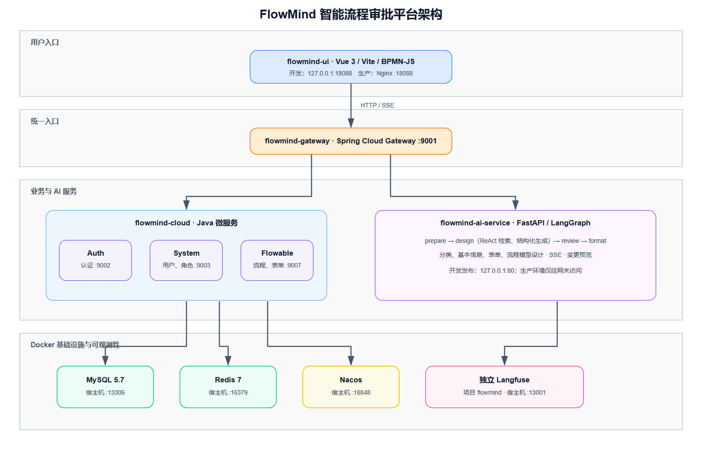

<p align="center">
  
</p>

<h1 align="center">FlowMind</h1>
<h4 align="center">AI-assisted workflow management powered by RuoYi-Cloud and Flowable</h4>

<p align="center">
  <a href="./README.md">简体中文</a> · <strong>English</strong>
</p>

<p align="center">
  <a href="https://github.com/Moonlight168/flowmind"></a>
  <a href="./LICENSE"></a>
  
</p>

FlowMind is an open-source workflow approval platform that combines visual BPMN modeling, form design, approval operations, and an AI design assistant. Users can describe a business process in natural language, review structured changes, and apply them to the current design only after confirmation.

## AI design workflow

| Category | What FlowMind generates |
| --- | --- |
| Workflow category | Name, key, and description |
| Model metadata | Workflow name, category, and business description |
| Form design | Fields, validation rules, options, and layout-compatible schema |
| BPMN design | Nodes, assignees, form bindings, listeners, and extension properties |

<table>
  <tr>
    <td><br><div align="center">Workflow category</div></td>
    <td><br><div align="center">Model metadata</div></td>
  </tr>
  <tr>
    <td><br><div align="center">Form design</div></td>
    <td><br><div align="center">BPMN design</div></td>
  </tr>
</table>

## Architecture



| Project | Stack | Responsibility |
| --- | --- | --- |
| [flowmind-ui](./flowmind-ui/README.md) | Vue 3, Element Plus, BPMN-JS, VForm 3 | Administration UI, approval workspace, and AI design interaction |
| [flowmind-cloud](./flowmind-cloud/README.md) | Spring Boot, Spring Cloud, Flowable | Gateway, identity, system data, and workflow execution |
| [flowmind-ai-flow](./flowmind-ai-flow/README.md) | FastAPI, LangGraph, LangChain | ReAct generation, validation, conversation state, and observability |

## Highlights

- **AI-assisted design** — generate workflow categories, model metadata, forms, and BPMN changes from natural language.
- **Review before apply** — field-level and node-level previews keep generated changes explicit and reversible.
- **ReAct agent** — retrieves existing categories, forms, roles, and models before proposing structured operations.
- **Visual modeling** — BPMN-JS process editor and VForm 3 form designer remain fully editable after generation.
- **Approval workspace** — launch requests, process tasks, inspect history, and manage drafts from one interface.
- **Production-ready stack** — Spring Cloud services, Flowable, FastAPI, Redis, MySQL, Nacos, and optional Langfuse observability.

## Quick start

### Production-like Docker stack

Build the Java services and frontend assets from the repository root:

```bat
bin\build.bat
```

Start the complete stack:

```bash
cd docker/flowmind
docker compose -f docker-compose.prod.yml up -d --build
```

Open <http://localhost:18088>.

### Docker development stack

The default development stack includes the frontend, AI service, and the Java services required by the AI design flow. Vue and FastAPI source changes reload automatically.

```bash
cd docker/flowmind
docker compose up -d --remove-orphans
```

Optional Java services such as File, Gen, Job, and Monitor can be enabled with:

```bash
docker compose --profile optional up -d
```

Langfuse runs as an independent infrastructure stack:

```bash
docker compose -f docker-compose.langfuse.yml up -d
```

## Local endpoints

| Service | Host endpoint |
| --- | --- |
| Web application | <http://localhost:18088> |
| Gateway | <http://localhost:9001> |
| Nacos console | <http://localhost:19090/nacos> |
| MySQL | `localhost:13306` |
| Redis | `localhost:16379` |
| Langfuse | <http://localhost:13001> |

The production AI container is not published directly to the host. Requests go through Gateway at `/flowmind-ai/**`, where identity is validated and forwarded as trusted user context.

## Development

- Frontend: see [flowmind-ui/README.md](./flowmind-ui/README.md)
- Java services: see [flowmind-cloud/README.md](./flowmind-cloud/README.md)
- AI service and evaluation: see [flowmind-ai-flow/README.md](./flowmind-ai-flow/README.md)
- Public project article: see [BLOG.md](./BLOG.md)

Please keep secrets and local `.env` files out of commits. Generated AI changes should remain reviewable and must not fabricate successful backend operations.

## License

FlowMind is available under the [MIT License](./LICENSE). It extends [RuoYi-Cloud](https://gitee.com/y_project/RuoYi-Cloud).
